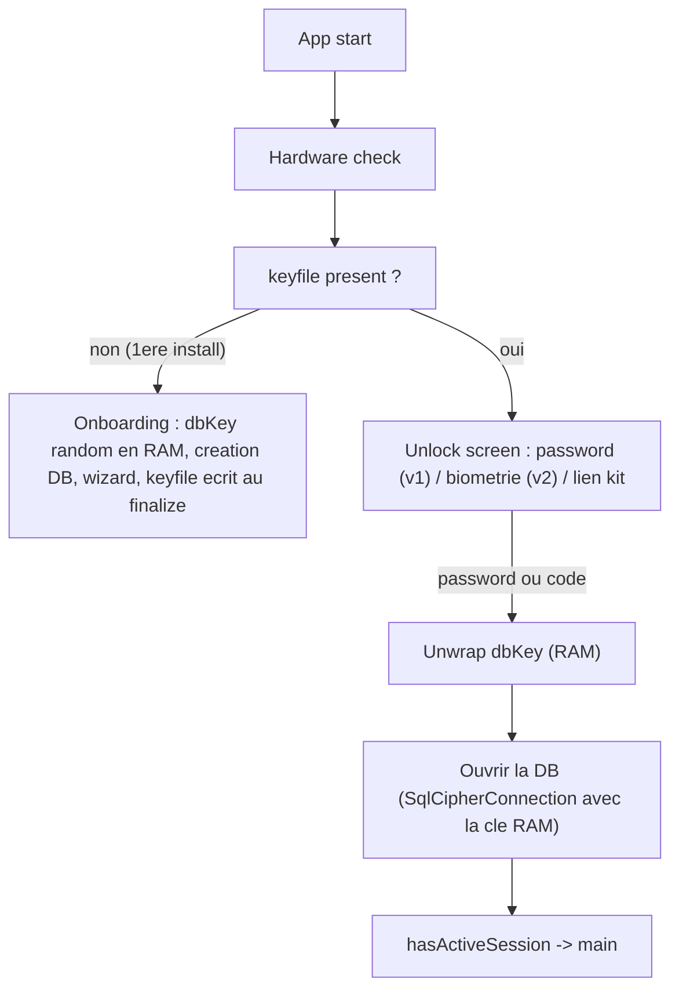

# Boot auth-gated — données radioactives, aucun accès sans facteur d'auth

*Statut : décision actée 07/11/2026 (« l'app ne boot pas autrement qu'avec password ou biométrie »). Ce doc remplace le débat Design A/B : c'est le Design A, implémenté sans re-chiffrement de la base et sans perdre le recovery kit. Prérequis livrés : SQLCipher (P6), restore in-device (P5).*

## 1. Décision

Les transcripts sont des données cliniques : **l'app n'affiche rien, ne lit rien, ne traite rien sans un facteur d'authentification** — password, ou biométrie (Face ID / empreinte digitale selon la plateforme). La clé SQLCipher **ne vit plus en clair sur l'appareil** : elle ne revoit le jour qu'en RAM, après auth.

## 2. Le keyfile — la clé DB n'a plus de domicile en clair

```
keyfile.json   (quelques octets, zéro PII, à côté de la base)
{
  "version": 1,
  "slots": {
    "password": { "salt": "scribe_dbkey_password_<uuid>", "wrapped": "<AES-GCM(dbKey, keyFromPassword(password, salt))>" },
    "recovery": { "salt": "scribe_dbkey_recovery_<uuid>", "wrapped": "<AES-GCM(dbKey, keyFromCode(code, salt))>" },
    "biometry": { "alias": "...", "wrapped": "..." }
  }
}
```

- `dbKey` = la clé SQLCipher random actuelle (hex 64). Elle n'existe qu'en RAM après unwrap.
- **v1 : slots `password` + `recovery` seulement** (décision 07/11 — password seul d'abord). Le slot `biometry` est réservé dans le format (champ Zod optionnel), implémenté en v2 — Face ID sur iOS, empreinte sur Android, via une clé Keystore/Enclave gated *user presence*.
- L'entrée SecureStore `scribe_db_cipher` disparaît — c'est elle qui permettait à l'app d'ouvrir la base sans personne.
- Le masterKey (`scribe_master_<uuid>`, en clair dans SecureStore aujourd'hui) devra suivre le même chemin plus tard — non bloquant pour v1.

## 3. Boot



- **Chicken-egg résolu** : le routing ne lit plus la DB avant auth. La présence du keyfile remplace `hasActiveSession` comme signal « un vault existe ».
- **Onboarding** : la base est créée avec un `dbKey` random tenu en RAM pendant le wizard ; le keyfile est écrit quand password et code existent (fin du wizard). App tuée en cours d'onboarding = pas de keyfile = onboarding repart de zéro, comme aujourd'hui pour un therapist non persisté.
- **Écran d'unlock** : champ password (v1), lien « J'ai un kit de récupération » → slot `recovery` → la base s'ouvre → re-wrap sous nouveau password (même mécanique que le `RestoreState` livré). **Changement de password** = réécriture des slots du keyfile, **jamais de `PRAGMA rekey`** — la clé DB est random et ne change jamais.

## 4. Traitement différé sous auth — « processé, ingéré uniquement quand authentifié »

L'audio reste stocké chiffré (`.dat`, AES-GCM natif) et la queue `ToProcess` survit au lock — **rien ne se perd, tout s'accumule**. Ce qui change : la pipeline (décrypt → transcribe → ingestion en base) ne tourne que dans une **fenêtre authentifiée** :

- Préconditions du scheduler de traitement : app foreground + session déverrouillée (+ chargeur en priorité, vision inchangée).
- Lock (background prolongé) → pause ; unlock → reprise automatique, la queue reprend où elle s'était arrêtée.
- Aucun travail n'est ingéré en base quand la session est fermée : la donnée « radioactive » n'existe en clair (RAM) que dans les fenêtres authentifiées.

## 5. Menaces & limites assumées

- **Téléphone volé rooté** : le dump trouve des blobs wrappés (keyfile) + la base chiffrée. Brute-force offline du password (entropie utilisateur) ou du code (60 bits uniformes). C'est le gain du Design A — la clé ne dort nulle part.
- **UX** : premier écran = unlock, à chaque lancement (v1 sans biométrie). La biométrie v2 est la réponse au coût de friction.
- **Brute-force en ligne** : impossible (tout est offline, local-first).
- Restore in-device et restore d'un bundle (cf. `BACKUP_RESTORE.md`) deviennent le même mécanisme : obtenir le `dbKey` (slot code/password) → ouvrir.

## 6. Chantier (ordre TDD)

| # | Étape | Gate |
|---|---|---|
| 1 | `DatabaseKeyfile` — format Zod + `wrap`/`unwrap` (pur) ; remplace le rôle de `DatabaseKeyVault` | round-trip, mauvais password, mauvais code |
| 2 | Boot refactor : gate avant `Database.initialize` ; routing par présence du keyfile ; `SqlCipherConnection` accepte une clé RAM | émulateur : base fraîche → onboarding → unlock → main |
| 3 | Écran Unlock (password + lien kit) branché sur le gate | parcours navigable, mauvais password = message |
| 4 | Traitement différé : précondition « session déverrouillée » dans le scheduler ; reprise après unlock | queue ToProcess reprise après lock/unlock |
| 5 | Kit sur l'écran d'unlock (slot recovery → nouveau password) | forgot-password E2E émulateur |
| 6 | (v2) Slot biométrie — `react-native-keychain` ou module natif ; Face ID / empreinte | unlock biométrique E2E |

Dépendances v1 : aucune nouvelle (tout est expo-file-system + CryptoEngine). v2 biométrie : à arbitrer.
